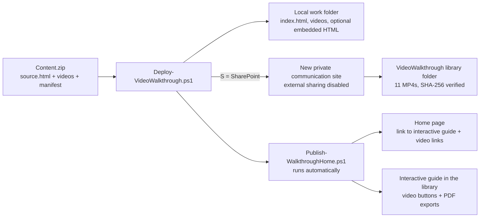

# Purview Copilot Walkthrough Kit

PowerShell kit that turns a packaged, interactive **Microsoft Purview controls for Microsoft 365 Copilot and Cowork** walkthrough (HTML guide + narrated MP4s) into:

- an **offline copy** you can open in Edge, and optionally
- a **private SharePoint communication site** whose Home page links to the interactive guide, with each video playing in the SharePoint video player and each card exportable as a PDF.

Built for IT admins and security leads in Commercial and GCC (Moderate) tenants. Windows PowerShell 5.1, delegated sign-in with browser MFA, no passwords collected.

> [!IMPORTANT]
> This is a community project, not an official Microsoft product or support offering. Review the scripts and validate in a test tenant before production use. GCC High and DoD are intentionally blocked.

> [!NOTE]
> The walkthrough content (`Content.zip`: guide HTML + videos) is **not** included in this repository. Supply your own package in the format described in [docs/CONTENT-PACKAGE.md](docs/CONTENT-PACKAGE.md), or obtain the content package from the kit author.

---

## Contents

- [What gets built](#what-gets-built)
- [Requirements](#requirements)
- [Quick start](#quick-start)
- [Scripts](#scripts)
- [Security design](#security-design)
- [Remove and rebuild](#remove-and-rebuild)
- [Troubleshooting](#troubleshooting)
- [Known limitations](#known-limitations)
- [Repository layout](#repository-layout)
- [License](#license)

## What gets built



| Output | Where | Notes |
|---|---|---|
| Offline walkthrough | `<WorkFolder>\index.html` + `videos\` | Open in Edge. Optional single-file `walkthrough-embedded.html` (~76 MB). |
| SharePoint site | `https://<tenant>.sharepoint.com/sites/<slug>` | Communication site, external sharing **disabled**, signed-in admin is primary owner. |
| Interactive guide | `Shared Documents/VideoWalkthrough/Copilot-Governance-Walkthrough.html` | Opens in the SharePoint file viewer, same look as the offline copy. |
| Videos | `Shared Documents/VideoWalkthrough/*.mp4` | Open in the SharePoint video player. |
| PDFs | `Shared Documents/VideoWalkthrough/pdf/` | One for all cards + one per card, built locally with Edge. |
| Home page | `SitePages/Home.aspx` | Intro, **Open the interactive walkthrough** link, direct video links. |

## Requirements

| Item | Requirement |
|---|---|
| OS / shell | Windows, **64-bit Windows PowerShell 5.1**, .NET Framework 4.7.2+ |
| Browser | Microsoft Edge (used headless to build the PDFs; skip with `-SkipPdf`) |
| Modules | `Microsoft.Online.SharePoint.PowerShell` (16.0+) and `Microsoft.Graph.Authentication` (2.0+). Installed for CurrentUser only if you opt in. |
| Installing account | **SharePoint Administrator or Global Administrator**. You sign in with this one account twice (Graph, then SharePoint admin) and it becomes the site primary owner. |
| Consent | Delegated `Sites.ReadWrite.All` for Microsoft Graph PowerShell (or your own tenant-approved public client via `-ClientId`) |
| Cloud | Commercial or GCC (Moderate). GCC High / DoD are blocked. |
| Content | A `Content.zip` that passes the checks in [docs/CONTENT-PACKAGE.md](docs/CONTENT-PACKAGE.md) |

Co-owners and business owners do **not** need an admin role; add them after deployment.

## Quick start

1. **Get the kit.** Download or clone this repository into an ordinary local folder outside OneDrive, for example `C:\VideoWalkthroughPackage`, and place your `Content.zip` next to the scripts.
2. **Review and unblock** the scripts according to your execution policy (the kit never bypasses it):

   ```powershell
   Set-Location 'C:\VideoWalkthroughPackage'
   Get-ChildItem *.ps1, *.cmd | Unblock-File   # only if your policy permits unblocking reviewed scripts
   .\Deploy-VideoWalkthrough.ps1 -ContentZipPath 'C:\VideoWalkthroughPackage\Content.zip' -Help
   ```

3. **Deploy** (wizard). Choose **S** for SharePoint and answer the prompts; the wizard re-asks any answer it cannot accept.

   ```powershell
   .\Deploy-VideoWalkthrough.ps1 -ContentZipPath 'C:\VideoWalkthroughPackage\Content.zip' -Cloud GCC   # or -Cloud Commercial
   ```

   - Sign in with the **same SharePoint/Global Administrator** account both times. Use Alt+Tab if a sign-in window is hidden.
   - At the work-folder prompt press **Enter** for `C:\VideoWalkthrough\<slug>`. Keep this folder: updates and removal use it.
   - Deploy finishes by publishing the interactive guide, PDFs and Home page, then prints the site URL.

4. **Add co-owners** (optional, no admin role needed for them):

   ```powershell
   Connect-SPOService -Url https://<tenant>-admin.sharepoint.com
   'user1@contoso.com','user2@contoso.com' | ForEach-Object { Set-SPOUser -Site https://<tenant>.sharepoint.com/sites/<slug> -LoginName $_ -IsSiteCollectionAdmin $true }
   ```

5. **Verify** as a viewer: open the site, select **Open the interactive walkthrough**, play a video and open a PDF.

A one-page, printable version of these steps is in [docs/QUICKSTART.html](docs/QUICKSTART.html); the full admin guide is [docs/ADMIN-GUIDE.md](docs/ADMIN-GUIDE.md).

## Scripts

All scripts support `-Help` (prints the parameter reference and exits without connecting) and `-WhatIf`.

| Script | Purpose |
|---|---|
| `Deploy-VideoWalkthrough.ps1` | Validates `Content.zip`, builds the offline copy, optionally creates the site, uploads and verifies videos, creates the text page, then runs `Publish-WalkthroughHome.ps1`. Resumable with `-ReuseExistingSite` in the same work folder. |
| `Publish-WalkthroughHome.ps1` | Reads the target site from the work folder, uploads the interactive guide, builds and uploads PDFs, rewrites `Home.aspx` (previous layout backed up to the work folder) and publishes it. Safe to rerun. |
| `Update-VideoWalkthrough.ps1` | Replaces content in an existing deployment (same-name videos, a new source folder, or a new `Content.zip`). Rerun `Publish-WalkthroughHome.ps1` afterwards. |
| `Remove-VideoWalkthrough.ps1` | Deletes only the site recorded in the work folder, purges it from the recycle bin (unless `-KeepInRecycleBin`), and renames the work folder. Typed-slug confirmation. |
| `VideoWalkthrough.Common.ps1` | Shared validation, hashing, ZIP and HTML safety functions (dot-sourced). |
| `Start-VideoWalkthrough.cmd`, `Update-VideoWalkthrough.cmd` | Double-click launchers for the built-in Windows PowerShell. |

## Security design

The kit is written to be reviewable and to fail closed. Controls built into the scripts:

**Identity and authorization**
- Delegated sign-in only, through the browser with MFA and Conditional Access. No passwords, secrets, certificates or app-only credentials are collected or stored.
- Graph context is process-scoped (`-ContextScope Process`) and disconnected at exit.
- After sign-in the script verifies the tenant ID, delegated auth type, granted scope, optional client ID, and that the SharePoint hostname matches the tenant's real root site before any change.
- The primary owner is always the signed-in account; no permissions are elevated and no other account is made owner by the installer.

**SharePoint changes**
- Creates a **new** communication site only. An existing URL is never adopted unless it is the site recorded in this work folder's state (`-ReuseExistingSite`). A URL in the recycle bin is refused.
- External sharing is disabled on the new site immediately after creation, before any content is uploaded.
- Every upload is verified byte-for-byte (SHA-256 of the downloaded remote file). Conflicting remote files are never overwritten without `-OverwriteAssets`; page overwrites require `-UpdateExistingPage` and an eTag match.
- No blind retries of non-idempotent requests; transient errors back off exponentially and honour `Retry-After` (capped at five minutes).
- Deployment state is checkpointed to `deployment-state.json` so interrupted runs resume without duplicating sites, files or pages.

**Content validation (`Content.zip`)**
- Manifest with SHA-256 and size for every file; undeclared, missing or unreferenced files are rejected.
- ZIP hardening: path-traversal and reserved names rejected, no symlink/directory/reparse entries, per-file 100 MB and total 250 MiB limits, compression-ratio (zip bomb) check.
- HTML portability checks: no inline event handlers, no `javascript:` URLs, no off-host scripts, styles or images, no personal OneDrive links, reference links must be credential-free HTTPS, screenshots must be embedded images.

**Local safety**
- Work folders must be local drive paths; UNC paths, alternate data streams, symlinks and reparse points (including synced-folder placeholders) are refused. New work folders must be empty.
- Error output is sanitized: raw HTTP responses, tokens and pre-authenticated URLs are never printed or logged; Graph errors show only their code and message with URLs removed.
- Structured logs (CSV / JSONL, UTF-8) record every action in the work folder.
- No execution-policy bypass; module installation only with explicit opt-in, CurrentUser scope, from PSGallery.
- PDFs are built by Edge in a temporary, isolated profile inside the work folder, which is deleted afterwards.

**Removal**
- `Remove-VideoWalkthrough.ps1` acts only on the site recorded in the work folder's state, checks the site template, requires typing the slug, supports `-WhatIf`, and renames rather than deletes local files. The recycle-bin purge is permanent by design and clearly warned.

See [SECURITY.md](SECURITY.md) for how to report a vulnerability.

## Remove and rebuild

```powershell
.\Remove-VideoWalkthrough.ps1 -WorkFolder 'C:\VideoWalkthrough\<slug>' -WhatIf   # preview
.\Remove-VideoWalkthrough.ps1 -WorkFolder 'C:\VideoWalkthrough\<slug>' -Force    # delete + purge (permanent)
```

Wait a few minutes for the URL to be released, then run Deploy again.

## Troubleshooting

| Message | Cause | Fix |
|---|---|---|
| `Join-Path : Cannot bind argument to parameter 'Path' because it is an empty string` | v2.2 launcher issue | Use v2.2.1+, or run Deploy with `-ContentZipPath` as shown above. |
| `SharePoint admin sign-in failed …` | Signed-in account lacks SharePoint Administrator / Global Administrator, or a different account was used for the second sign-in | Sign in with one admin account for both prompts. |
| `OwnerUpn differs from the authenticated account` | `-OwnerUpn` was set to someone other than the signed-in admin | Omit `-OwnerUpn`; add other owners afterwards. |
| `Site URL is in the recycle bin` | Same slug was recently deleted | Wait, purge it, or choose another slug. |
| `Work folder belongs to different inputs/payload` | Reusing a work folder with different answers | Use a new work folder, or the same answers to resume. |
| Videos or PDF buttons do nothing in the guide | Guide published before v1.2 of `Publish-WalkthroughHome.ps1` | Rerun `Publish-WalkthroughHome.ps1 -WorkFolder <folder> -Force`. |
| Graph error with a code in brackets | Tenant-side rejection | The bracketed Graph code/message names the cause. |

## Known limitations

- Windows PowerShell 5.1 on Windows only for hosted deployment (`-LocalOnly` builds the offline copy anywhere the script runs).
- The SharePoint file viewer blocks inline video and printing inside HTML, so the hosted guide uses links to the SharePoint player and pre-built PDFs.
- Graph v1.0 cannot add an Embed web part, so the Home page links to the guide rather than embedding it.
- The updater has not yet been validated on a live tenant; the double-click launchers have not been retested since v2.2.1.

## Repository layout

```
.
├── Deploy-VideoWalkthrough.ps1
├── Publish-WalkthroughHome.ps1
├── Update-VideoWalkthrough.ps1
├── Remove-VideoWalkthrough.ps1
├── VideoWalkthrough.Common.ps1
├── Start-VideoWalkthrough.cmd
├── Update-VideoWalkthrough.cmd
├── docs/
│   ├── QUICKSTART.html      # printable admin quick start
│   ├── ADMIN-GUIDE.md       # full admin guide
│   └── CONTENT-PACKAGE.md   # Content.zip format and how to build one
├── .github/workflows/validate.yml   # parse, ASCII, -Help and PSScriptAnalyzer checks
├── CHANGELOG.md
├── CONTRIBUTING.md
├── SECURITY.md
└── LICENSE
```

## License

[MIT](LICENSE). Author: David Liu.
